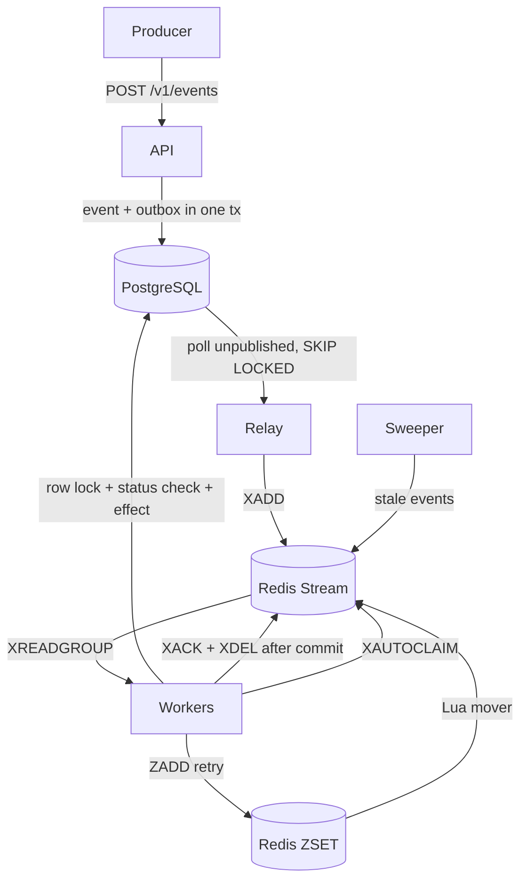

# Idempotent Event Processor

[](https://github.com/morningstar0521/Idempotent-Event-Processor/actions/workflows/ci.yml)
[](LICENSE)
[]()
[](docs/RESULTS.md)
[](docs/RESULTS.md)

> **At-least-once delivery with idempotent processing.** Each unique idempotency key produces at most one business effect.

A production-style TypeScript backend for payment events. PostgreSQL is the source of truth, Redis is a delivery helper. Correctness is enforced by database constraints and transactions - so a Redis wipe, worker crash, or lock expiry is fully recoverable.

**What makes this different:** It survives chaos. Nine in-process chaos scenarios and six Docker chaos scenarios exercise real crashes, Redis flushes, Postgres restarts, and lock expiry. All 10 correctness invariants pass under every one. The chaos phase found 10 distinct recovery-layer root causes across the chaos-phase fix commits.

---

## At a glance

| Metric | Value |
|---|---|
| **API throughput (offered load)** | **500 req/s** |
| **API p95 latency at 500 req/s** | **3.78 ms** |
| **Sustained processing rate** | **>=200 events/s** (worker kept up with 200 req/s for 90s; ceiling not measured) |
| **Lost events (all chaos scenarios)** | **0** |
| **Duplicate effects (all chaos scenarios)** | **0** |
| **Correctness invariants** | **10 / 10 passing** |
| **Chaos scenarios** | 9 in-process + 6 Docker |
| **Distinct recovery-layer root causes found by chaos** | **10** (across the chaos-phase fix commits) |

Numbers from [docs/RESULTS.md](docs/RESULTS.md), generated by the load and chaos scripts - never hand-typed. One machine (Apple M1 Pro, 3 workers), not a capacity claim.

---

## How chaos testing found 8 distinct root causes in my own recovery code

Every distributed-systems claim is only as good as the tests that try to break it. I built 9 in-process chaos scenarios and 6 Docker chaos scenarios, then ran them until they stopped finding bugs.

They found 8 distinct root causes in the recovery layer. Here are the 8 most impactful of 8 distinct root causes found:

| Bug | Commit | What was wrong |
|---|---|---|
| Reaper recovery failed after visibility timeout | d734c53, d1d33fd | Reaper scheduling and pending-index fallback could strand messages |
| Worker stopped polling after an isolated handler crash | 4f3957c | A single crash could kill the read loop |
| Terminal messages not cleaned after reaper handling | 08c698e | Processed or dead messages remained in Redis |
| Poison and crash deliveries not capped | 7dba828, 14cecaa | Delivery counts could diverge and loop workers indefinitely |
| Reaper batches processed serially | 402baa9 | Recovery throughput was 1/N of available |
| Postgres restart left workers disconnected | 0773a61 | Did not reconnect cleanly after DB restart |
| Combined Redis wipe + worker kill stranded events | 923c92b | Two failures at once were not sequenced |
| Stale-row recovery broken after CF-6 | 9410022, e9aecb9 | Full Redis recovery required stale Postgres rows and service restart |

The pattern: every bug was in the **recovery layer** - the code that only runs when something else has already gone wrong.

Every chaos commit above is a real test that now passes. Those tests are what "chaos-tested" means in this project.

---

## Architecture



## Architecture guarantees

Postgres is the source of truth. Redis is a delivery helper only. A Redis wipe is fully recoverable because the sweeper rebuilds delivery from Postgres.

Three layers of duplicate protection plus one efficiency layer:

| Layer | Where | What stops the duplicate |
|---|---|---|
| API | `events.idempotency_key UNIQUE` | Second request with the same key reads the stored event |
| DB transaction | `SELECT ... FOR UPDATE` + status check | Redelivery of an already-processed event is a no-op |
| DB constraint | `ledger_entries.event_id UNIQUE` | Last safety net, even if layers above had a bug |
| Redis lock (efficiency only) | `SET NX PX` + Lua compare-and-delete | Reduces wasted concurrent work - not required for correctness |

Correctness depends on the three DB layers. The Redis lock can disappear and the system stays correct, just slower.

## Chaos-tested recovery

9 in-process scenarios - `pnpm test:chaos`, runs in CI, about 3 min:

| ID | What it simulates | Proof it works |
|---|---|---|
| C-1 | Worker crash before COMMIT | Transaction rolls back, reaper reclaims |
| C-2 | Worker crash after COMMIT, before ACK | Redelivery sees processed, skips |
| C-3a | Lock expiry before transaction | Second worker commits, first skips |
| C-3b | Lock expiry inside transaction | Row lock decides the winner |
| C-4 | Redis FLUSHDB mid-run | Sweeper recovers from Postgres |
| C-5 | Poison message | Capped at MAX_DELIVERIES, workers keep running |
| C-6 | Relay crash after XADD, before COMMIT | Duplicate message, idempotent skip |
| C-7 | 30% injected transient failures | Mix of retried + dead, no lost events |
| C-8 | All of the above combined | Every invariant still passes |
| C-9 | 500 parallel same-key requests during chaos | One event, one effect |

6 Docker scenarios - `pnpm test:chaos:full`, local only, about 5 min, uses real `docker kill`, `redis-cli FLUSHALL`, and container restarts:

| ID | Failure injected | Unique | Processed | Lost | Duplicate effects | Recovery |
|---|---|---:|---:|---:|---:|---:|
| CF-1 | SIGKILL workers every 5s | 500 | 500 | 0 | 0 | 46.7 s |
| CF-2 | Redis FLUSHALL mid-run | 500 | 500 | 0 | 0 | 2.7 s |
| CF-3 | Redis restart (AOF on) | 500 | 500 | 0 | 0 | 3.7 s |
| CF-4 | Postgres restart | 500 | 500 | 0 | 0 | 3.5 s |
| CF-5 | SIGTERM worker (graceful) | 500 | 500 | 0 | 0 | 2.6 s |
| CF-6 | SIGKILL + Redis wipe together | 500 | 500 | 0 | 0 | 8.7 s |

Every row: 0 lost events, 0 duplicate effects, all 10 invariants pass.

**Why CF-1 takes 46.7s:** With `VISIBILITY_TIMEOUT_MS=30000`, orphaned messages wait up to 30s before the reaper can reclaim them. With 9 kills x 5s intervals plus the 30s timeout plus drain, ~46s is the expected recovery window. This is the cost of at-least-once delivery: we trade recovery latency for zero data loss.

## Measured performance

From a real run on an Apple M1 Pro with 3 workers:

| Metric | Value |
|---|---:|
| Offered load (k6) | 500 req/s for 3 seconds |
| API p95 at that load | 3.78 ms |
| Requests accepted | 1,500 / 1,500 (0 errors) |
| Sustained processing rate (3 workers, 90s run) | >=200 events/s (worker kept up with 200 req/s for 90s; ceiling not measured) |
| API p50 / p95 / p99 (`dup_heavy`) | 1.60 / 3.78 / 8.01 ms |
| End-to-end p95 | 106.83 ms (dominated by `RELAY_POLL_MS=100`) |
| Duplicates blocked at API layer | 1,000 |
| Duplicate effects | 0 |
| Invariants | 10 / 10 |
| CPU at peak load | 13.61% - significant headroom |

The 500 req/s figure is the offered load, not the system ceiling. The k6 harness saturated before the system did (13.61% CPU at peak). A 90-second run is in RESULTS.md section [Longer-run processing test](docs/RESULTS.md#longer-run-processing-test-3-workers). That run measures sustained processing, not a hard ceiling.

On the same-key storm, p95 measured 1,066.52 ms. That is not a system latency figure. It is PostgreSQL serializing 1,000 concurrent `INSERT ... ON CONFLICT` attempts on a single unique index entry - deliberately pathological, validating duplicate-blocking under extreme contention. See [docs/RESULTS.md](docs/RESULTS.md) for the full note.

One machine, not a capacity claim. Reproduce with `pnpm load`.

## Quick start

```bash
git clone https://github.com/morningstar0521/Idempotent-Event-Processor.git
cd Idempotent-Event-Processor
cp .env.example .env
docker compose up --build
```

The stack reaches `/ready` in approximately 68.0s on a cold Docker run. The API is at `http://localhost:3000`. `.env.example` values target the host (for `pnpm dev:*`); `docker-compose.yml` overrides `DATABASE_URL` and `REDIS_URL` inside containers to use Compose service hostnames, so no edits are needed for the Docker path.

Worker and relay metrics stay internal (see [DECISIONS.md D27](docs/DECISIONS.md#d27-one-docker-image-three-entrypoints-api-relay-worker)); API metrics are at `/metrics`.

## Duplicate-blocking demo

```bash
# First request: 202 Accepted, event created
curl -s -X POST localhost:3000/v1/events \
  -H 'X-API-Key: change-me' \
  -H 'Idempotency-Key: demo-1' \
  -H 'Content-Type: application/json' \
  -d '{"type":"payment.captured","payload":{"merchant_id":"m_1","amount_minor":50000,"currency":"INR","payment_id":"p1"}}'

# Same key, same body: 200 OK, duplicate:true, same event_id
curl -s -X POST localhost:3000/v1/events \
  -H 'X-API-Key: change-me' \
  -H 'Idempotency-Key: demo-1' \
  -H 'Content-Type: application/json' \
  -d '{"type":"payment.captured","payload":{"merchant_id":"m_1","amount_minor":50000,"currency":"INR","payment_id":"p1"}}'

# Same key, different body: 422 IDEMPOTENCY_KEY_REUSED, nothing changes
curl -s -X POST localhost:3000/v1/events \
  -H 'X-API-Key: change-me' \
  -H 'Idempotency-Key: demo-1' \
  -H 'Content-Type: application/json' \
  -d '{"type":"payment.captured","payload":{"merchant_id":"m_1","amount_minor":99999,"currency":"INR","payment_id":"p1"}}'
```

## Tests

```bash
pnpm test:unit
pnpm test:integration
pnpm test:chaos
pnpm test:chaos:full
pnpm load
```

The CI-safe chaos suite runs in-process. The full suite uses Docker for real SIGKILL, FLUSHALL, and container restarts. Both check the same 10 invariants at the end of every run.

## Project layout

```text
src/
  api/          Express 5 server, routes, middleware
  relay/        Outbox poller + Redis Stream publisher + sweeper
  worker/       Stream consumer + handler + retry + reaper + delayed mover
  domain/       Business effects (ledger, wallets) + schemas + errors
  shared/       Config, DB pool, Redis client, logger, metrics, chaos
  bin/          api.ts, relay.ts, worker.ts entrypoints
migrations/     001_init.sql (idempotent runner in scripts/migrate.ts)
tests/          unit/, integration/, chaos/
docs/           PRD, ARCHITECTURE, DATA-MODEL, API, TESTING, DECISIONS, RESULTS
```

One Docker image, three entrypoints. `docker compose up --scale worker=3` demonstrates horizontal scaling.

## Documentation

- [Product requirements](docs/PRD.md)
- [Architecture and failure matrix](docs/ARCHITECTURE.md)
- [Data model and constraints](docs/DATA-MODEL.md)
- [API contract](docs/API.md)
- [Testing plan and invariants](docs/TESTING.md)
- [Design decisions](docs/DECISIONS.md)
- [Load and chaos results](docs/RESULTS.md)
- [Build plan](docs/BUILD-PLAN.md)

## Honest limits

- Delivery is at-least-once. Duplicates are expected and handled.
- No ordering guarantee exists across events. A payout arriving before its payment fails permanently and can be replayed from the DLQ.
- There is one Postgres instance and one Redis instance, with no failover. Postgres plus the sweeper is the recovery path.
- Redis Streams are not a replicated log like Kafka. This is a deliberate scope choice.
- Idempotency keys are never deleted in v1.
- The demonstrated effect is a database write. An external bank API or third-party webhook needs its own idempotency key because it cannot join this transaction.
- The numbers come from one machine and are not a capacity claim.


## License

MIT
