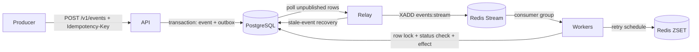

# Idempotent Event Processor

> At-least-once delivery with idempotent processing. Each unique idempotency key produces at most one business effect.

A small production-style TypeScript backend for payment events. PostgreSQL is the source of truth. Redis provides delivery, delayed retry, and lock helpers. Correctness is enforced by database constraints and transactions, so a Redis loss is recoverable.

## Quick start

```bash
git clone https://github.com/morningstar0521/Idempotent-Event-Processor.git
cd idempotent-event-processor
cp .env.example .env
docker compose up --build
```

The API listens on `http://localhost:3000`. The Compose stack starts Postgres and Redis, runs the migration once, then starts the API, relay, and worker. Worker and relay metrics stay internal to the Compose network; API metrics are available at `/metrics`.

### Duplicate demo

```bash
curl -s -X POST localhost:3000/v1/events -H 'X-API-Key: change-me' -H 'Idempotency-Key: demo-1' -H 'Content-Type: application/json' -d '{"type":"payment.captured","payload":{"merchant_id":"m_1","amount_minor":50000,"currency":"INR","payment_id":"p1"}}'
curl -s -X POST localhost:3000/v1/events -H 'X-API-Key: change-me' -H 'Idempotency-Key: demo-1' -H 'Content-Type: application/json' -d '{"type":"payment.captured","payload":{"merchant_id":"m_1","amount_minor":50000,"currency":"INR","payment_id":"p1"}}'
# The first response is 202; the second is 200 with duplicate: true and the same event_id.
```

## Architecture



Processing is: validate and hash the request, write the event and outbox row in one transaction, publish the event, then process it under a Postgres row lock and status check. The database transaction commits before Redis acknowledgement. A sweeper rebuilds delivery from Postgres when Redis is wiped.

## Duplicate protection

| Layer | Protection |
|---|---|
| API | Unique `idempotency_key` and payload-hash comparison reject reuse with a different body. |
| Redis lock | A TTL lock reduces concurrent work and uses compare-and-delete release. It is an efficiency aid. |
| Database status | A row lock and status check make already processed events no-ops. |
| Ledger constraint | Unique `ledger_entries.event_id` is the final database guard. |

## Failure matrix

| Failure | Safe outcome |
|---|---|
| Same key in parallel | One event wins; other requests read the stored event. |
| Same key with a different body | The API returns 422 and changes nothing. |
| API or relay crash around commit/publish | Stored events remain available; duplicate stream messages are safely skipped. |
| Worker crash before commit | The transaction rolls back and the reaper reclaims the message. |
| Worker crash after commit before ack | Redelivery sees `processed` and skips the effect. |
| Lock expiry during slow work | The database row lock decides the winner; the other worker skips. |
| Transient failure or exhausted retries | Backoff is stored and later retried; exhausted events become `dead`. |
| Permanent failure | The event becomes `dead` with no retry and appears in the DLQ. |
| Poison message or worker termination | Delivery limits and graceful shutdown prevent unbounded stuck work. |
| Redis loss | The Postgres sweeper re-enqueues stale `received` and `retrying` events. |
| Postgres outage | The API returns 503 and workers do not acknowledge uncommitted work. |
| Replay contention | One conditional update wins; later replay calls are rejected. |

The full F1-F16 matrix is in [ARCHITECTURE.md](docs/ARCHITECTURE.md#8-failure-matrix-the-heart-of-the-project).

## Measured run

`docs/RESULTS.md` is generated from a real run on an Apple M1 Pro with three workers. The `dup_heavy` scenario sent 1,500 requests for 500 unique keys: 500 returned 202, 1,000 returned 200, and there were 0 errors. Measured ingest rate was 499.86 requests/sec and processed rate was 172.53 events/sec.

API latency for `dup_heavy` was 1.60 ms p50, 3.78 ms p95, and 8.01 ms p99. End-to-end p95 was 106.83 ms. All 10 invariants passed, with 1,000 duplicates blocked at the API layer and 0 duplicate effects. The report also records six chaos-full scenarios, each with 500 processed events, 0 lost events, and 0 duplicate effects.

These values describe one machine and are not a capacity claim. The pathological same-key scenario measured 1,066.52 ms API p95 because PostgreSQL serialized 1,000 concurrent attempts on one unique index entry.

## Tests and chaos demo

```bash
pnpm install --frozen-lockfile
pnpm lint
pnpm typecheck
pnpm test:unit
pnpm test:integration
pnpm test:chaos
pnpm test:chaos:full
```

The CI-safe chaos suite runs in-process. The full suite uses the Compose stack and local Docker failure actions. Both finish by checking the database, ledger, outbox, retry, Redis, and money invariants.

## Acceptance coverage

- Concurrent same-key requests produce one event and one ledger effect.
- Duplicate-heavy load preserves all invariants.
- Worker kills, crashes after commit, lock expiry, and Redis loss are covered by chaos and recovery tests.
- Permanent failures dead-letter after one attempt; replay after fixing the cause is supported.
- Real load and chaos results are recorded in [docs/RESULTS.md](docs/RESULTS.md).
- API, readiness, wallet verification, DLQ, replay, and metrics endpoints are documented in [docs/API.md](docs/API.md).

## Honest limits

- Delivery is at-least-once; duplicates are expected and handled.
- There is no global ordering across events.
- This setup uses one Postgres and one Redis instance, with no failover.
- Redis Streams are not a replicated log; Postgres plus the sweeper is the recovery path.
- Idempotency keys are never deleted in v1.
- The demonstrated effect is a database write. An external bank or payment API must support its own idempotency key because it cannot join this database transaction.
- Results come from one machine and are not a capacity claim.

## Documentation

- [Product requirements](docs/PRD.md)
- [Architecture and failure matrix](docs/ARCHITECTURE.md)
- [Data model](docs/DATA-MODEL.md)
- [API contract](docs/API.md)
- [Testing plan](docs/TESTING.md)
- [Build plan](docs/BUILD-PLAN.md)
- [Design decisions](docs/DECISIONS.md)
