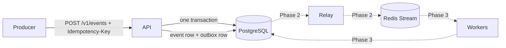

# Idempotent Event Processor

A small production-style TypeScript backend for accepting payment events with at-least-once delivery and idempotent processing. Each unique idempotency key produces at most one business effect.

The project uses PostgreSQL as the source of truth. Redis is used for delivery helpers, delayed retries, and worker coordination. The current implementation covers Phase 1: the ingest API and transactional outbox.

## Current status

Implemented:

- `POST /v1/events` for `payment.captured` and `payout.requested`
- Idempotency keys from 1 to 255 characters
- Stable SHA-256 payload hashing
- Strict Zod payload validation
- Atomic event and outbox writes in one PostgreSQL transaction
- Duplicate request handling with 202, 200, and 422 responses
- `GET /v1/events/:id` without returning the event payload
- API-key authentication using `crypto.timingSafeEqual`
- Structured request logging and Prometheus metrics
- Isolated integration tests using `events_test` and Redis DB 15

Relay publishing, workers, retries, dead-letter handling, sweeper recovery, chaos scenarios, and load reports are planned for later phases.

## Architecture



For a new request, the API validates the body, hashes `{type, payload}`, inserts the event using the unique idempotency key, inserts the outbox row, and commits both writes together. A repeated key reads the existing event and compares the stored payload hash.

## Stack

- TypeScript, Node.js 20, Express 5
- PostgreSQL 16 with `pg` and parameterized SQL
- Redis 7 with `ioredis`
- Zod validation, Pino JSON logging, Prometheus metrics
- Vitest tests, pnpm, Docker Compose

## Quick start

Start the local dependencies:

```bash
docker compose up -d postgres redis
pnpm install --frozen-lockfile
pnpm migrate
pnpm dev:api
```

The API listens on `http://localhost:3000`. Configuration defaults are in `src/shared/config.ts`. Copy the documented values into `.env` when overrides are needed. Do not commit `.env` or secrets.

## API example

Create an event:

```bash
curl -i -X POST localhost:3000/v1/events \
  -H 'X-API-Key: change-me' \
  -H 'Idempotency-Key: payment-1' \
  -H 'Content-Type: application/json' \
  -d '{"type":"payment.captured","payload":{"merchant_id":"m_1","amount_minor":50000,"currency":"INR","payment_id":"p1"}}'
```

Responses:

- `202`: new event, `duplicate: false`
- `200`: same key and same body, `duplicate: true`
- `422`: same key with a different body, `IDEMPOTENCY_KEY_REUSED`
- `400`: invalid body or idempotency key
- `401`: missing or invalid API key
- `503`: PostgreSQL unavailable

Public operational endpoints are:

- `GET /health`
- `GET /ready`
- `GET /metrics`

## Tests and checks

```bash
pnpm typecheck
pnpm lint
pnpm test:unit
pnpm test:integration
```

Integration tests create and migrate `events_test`, use a separate PostgreSQL pool, and flush Redis DB 15 between tests. The production `events` database is not used by the integration suite.

The Phase 1 API suite verifies validation, authentication, duplicate requests, concurrent same-key requests, transactional outbox rollback, unavailable PostgreSQL handling, and event lookup.

## Project documentation

- [Product requirements](docs/PRD.md)
- [Architecture and failure matrix](docs/ARCHITECTURE.md)
- [Data model](docs/DATA-MODEL.md)
- [API contract](docs/API.md)
- [Testing plan](docs/TESTING.md)
- [Build plan](docs/BUILD-PLAN.md)
- [Design decisions](docs/DECISIONS.md)

## Known limits

- Only INR is supported in v1.
- Events are stored indefinitely in v1.
- There is no cross-event ordering guarantee.
- PostgreSQL and Redis are single local services at this stage.
- The business effect is represented by database writes; an external payment provider would need its own idempotency mechanism.
